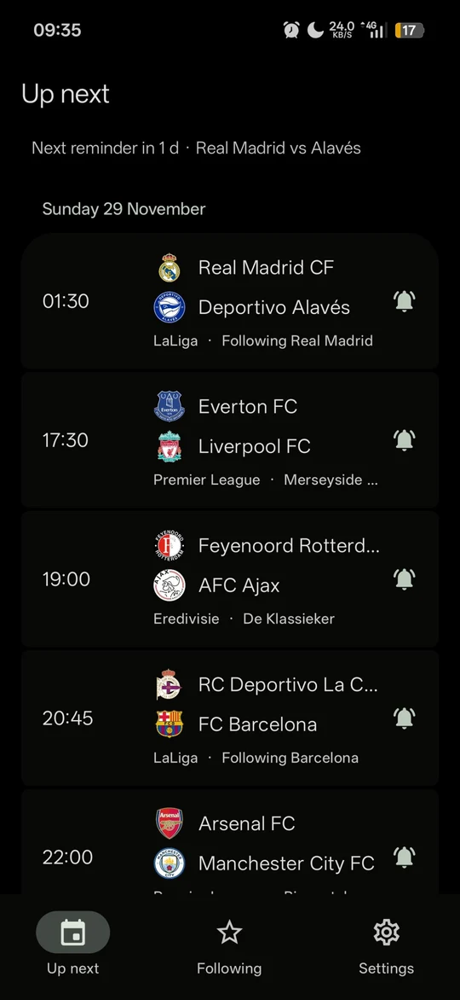
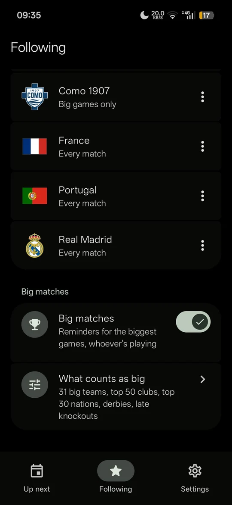

<h1 align="center">Regista</h1>

Football match reminders, and nothing else. No feed, no live scores: a nudge before the matches you care about.

<a href="../../releases/latest"><b>Download the latest APK</b></a>

  
  &nbsp;&nbsp;
  

Regista tells you a day, an hour and 5 minutes before kick-off, then gets out of the way. It covers the teams you
follow and the big games you'd hate to miss, even between teams you don't follow.

## Features

**Up next**
- Every upcoming reminder grouped by day, with why it's there ("Following Real Madrid", "El Clásico",
  "Champions League semi-final", "Big match")
- Tap a match for the details or to mute it; reminders carry a "Mute this match" button too
- Warns you if notifications, exact alarms or battery settings would make a reminder late

**Following**
- Clubs and national teams, each on *Every match* or *Big games only* (so Como v Inter reminds you, Como v Genoa doesn't)
- Find a team by name, or by one of its players

**Big matches**
- Both teams big, derbies and rivalries, or late knockout rounds, whoever's playing
- "Big" is a list you can edit (Real Madrid, Liverpool, Spain…), plus optionally Europe's top 10–50 clubs by [Elo](http://clubelo.com)

**Reminders**
- 1 day, 1 hour and 5 minutes before, each on or off; one notification per match, so the badge counts matches
- Rebuilt after reboots, updates and time-zone changes

**Settings**
- Theme (System / Light / Dark), pure black, the app's font, and a choice of app icons
- Updates from inside the app: a card on Up next when a new version is out

Fixtures come from ESPN's public API (no key): the big five leagues, Champions/Europa/Conference League, cups,
friendlies and qualifiers. If ESPN stops answering, Regista falls back to
[football-data.org](https://www.football-data.org) once you add a free token in Settings.

## Install

Download `Regista-x.y.z.apk` from the [latest release](../../releases/latest) and open it on your phone. For
reminders to arrive on time, allow notifications and exact alarms and set battery use to *Unrestricted* (Up next
shows what's missing). What changed in each version is in [CHANGELOG.md](CHANGELOG.md).

## Part of a family

Four small Android apps built to look and behave like one set: same icon palette, Material 3 Expressive with your
wallpaper's colours, pure black mode, any Google Font for the app, the same settings layout, and in-app updates
from GitHub Releases.

| | |
|---|---|
| [**Aria**](https://github.com/savar95x/aria-player) | Music player for your local files |
| [**Minutia**](https://github.com/savar95x/minutia) | Clock widget where every detail is yours |
| [**Hiatus**](https://github.com/savar95x/hiatus) | How long you've been away from your phone |
| [**Regista**](https://github.com/savar95x/regista) | Reminders for the football matches you care about |

## Building

GitHub Actions builds every push. Bumping `VERSION_NAME` in `version.properties` with a matching
`CHANGELOG.md` section publishes a release. Working on it with an AI agent? Start with [CLAUDE.md](CLAUDE.md).
